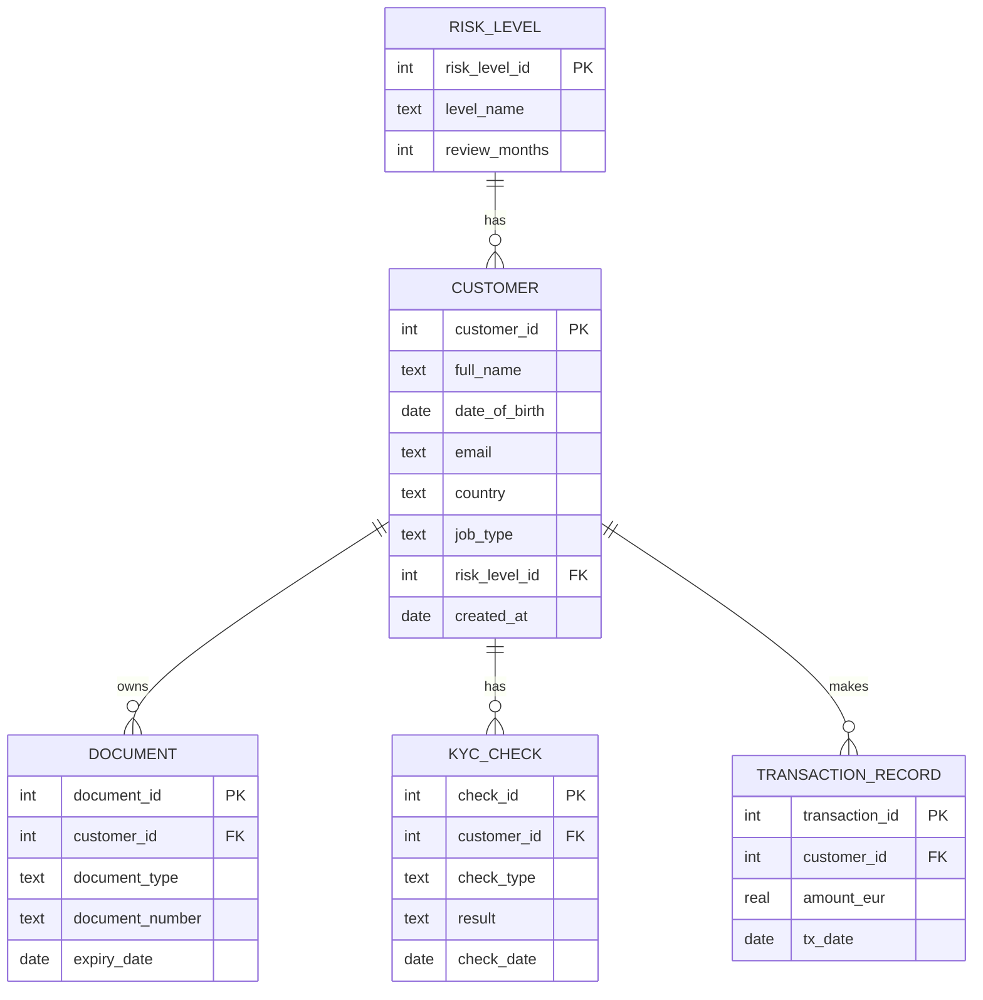

# ER Diagram

GitHub shows this diagram automatically (Mermaid).

## Relationships (in simple words)
- One risk level can belong to many customers. Each customer has one risk level.
- One customer can have many documents, many KYC checks and many transactions.

## Relational model
- RISK_LEVEL(**risk_level_id**, level_name, review_months)
- CUSTOMER(**customer_id**, full_name, date_of_birth, email, country, job_type, *risk_level_id*, created_at)
- DOCUMENT(**document_id**, *customer_id*, document_type, document_number, expiry_date)
- KYC_CHECK(**check_id**, *customer_id*, check_type, result, check_date)
- TRANSACTION_RECORD(**transaction_id**, *customer_id*, amount_eur, tx_date)

(**bold** = primary key, *italic* = foreign key)
